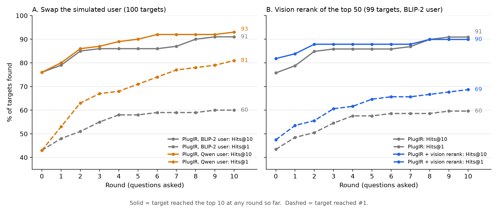

# Qwen user baseline and vision reranking

Two changes Matan suggested at the Nov 19 meeting, tested on targets 151–250.

1. **New baseline: Qwen2.5-VL-3B plays the simulated user, replacing BLIP-2.**
   Use it for every new comparison.
2. **Vision reranking:** a vision model judges PlugIR's top 50 at each round and moves the photos it
   accepts to the front.

**Metric:** Hits@10 is the metric we report. Recall@10 is only for debugging.

**Hits@k:** the target reached the top k at *any* round up to round t. It is cumulative, so it never
goes down. Recall@10 checks only round t's own top 10.

## What changed (read this first if you build on the code)

| Part | Before | Now |
|---|---|---|
| Questioner | Qwen3-4B-Instruct-2507 (PlugIR's prompts, minimum-KL choice) | unchanged |
| Search | BLIP (`blip-itm-large-coco`) over 50k COCO images | unchanged |
| **Simulated user** | BLIP-2 flan-t5-xl, prompt `Question: … Answer:` | **Qwen2.5-VL-3B-Instruct** (`--answerer qwen_vl`) |

### Code

- `QwenVLAnswerer` in [src/agentir/live_models.py](src/agentir/live_models.py)
  - Same interface as `Blip2Answerer`, so the PlugIR loop is untouched.
  - It receives the target photo, current search description, and selected question.
    The description starts as the initial caption and is updated from the dialogue
    after each answered question. The [original PlugIR code](https://github.com/Saehyung-Lee/PlugIR/blob/main/generate_dialog.py#L561-L564)
    passes the same inputs to BLIP-2.
  - Decoding is greedy, at most 24 new tokens, with images up to 512×28×28 pixels.
  - Answers are cached per (photo, description, question) in `answerer_calls/`.
  - Prompt (`QwenVLAnswerer.PROMPT`): answer in a short phrase with the specific detail asked for
    (a colour, a number, an object, a place). If the photo doesn't show it, say what is visible instead.
- [src/agentir/live.py](src/agentir/live.py): `prepare_live_experiment(..., answerer="blip2" | "qwen_vl")`.
  - The default `blip2` leaves the run identity unchanged, so old run folders still resume.
  - `qwen_vl` adds `identity["answerer"]`, so its runs get their own folder.
- [run_evaluation.py](run_evaluation.py): the shared comparison defaults to `ANSWERER = "qwen_vl"` for PlugIR, critique and debate. Set it to `"blip2"` to use the original answerer.
- [scripts/run_plugir_live.py](scripts/run_plugir_live.py): new flag `--answerer qwen_vl`.

### Rerank a saved three-method comparison

Use the folder printed by the comparison runner. Run both commands for each of
`plugir`, `critique` and `debate` by changing `--method`. Each method reads its
own dialogue and writes results under `<run>/vlm_judge/<method>/`.

```bash
python scripts/vlm_judge.py rerank --experiment runs/experiments/<run> --method debate
python scripts/vlm_judge.py score --experiment runs/experiments/<run> --method debate
```

### How to run the new baseline

Run on the GPU VM. About 7 minutes per target on an L4.

```bash
PYTHONPATH=src python scripts/run_plugir_live.py --start 150 --targets 10 --answerer qwen_vl
```

`--start 150` is target 151. Running in blocks of 10 is safe: blocks share one run folder.

Qwen3-4B and Qwen2.5-VL-3B take turns on the GPU. Each one parks in CPU RAM while the other runs.

## Result 1: Qwen user vs BLIP-2 user (100 targets, same questioner and search)

| Round | 0 | 1 | 2 | 5 | 10 |
|---|---|---|---|---|---|
| BLIP-2 user, Hits@10 | 76 | 79 | 85 | 86 | 91 |
| **Qwen user, Hits@10** | 76 | 80 | 86 | 90 | **93** |
| BLIP-2 user, Hits@1 | 43 | 48 | 51 | 58 | 60 |
| **Qwen user, Hits@1** | 43 | 53 | 63 | 71 | **81** |
| BLIP-2 user, Recall@10 | 76 | 71 | 74 | 72 | 67 |
| **Qwen user, Recall@10** | 76 | 77 | 79 | 85 | **87** |

- **Hits@10 at round 10:** +2. The 95% bootstrap CI is −2 to +7, so PlugIR is close to its ceiling.
- **Repeated questions:** 22% with BLIP-2, 12% with the Qwen user.
- **Why it matters:** BLIP-2 often gives non-answers ("a car", "yes"), which make PlugIR's query drift.
  Recall@10 *falls* over the rounds with BLIP-2 and *rises* with Qwen.
- **Data:** [results/conversations/plugir_qwen_qwenuser_targets_151_250.json](results/conversations/plugir_qwen_qwenuser_targets_151_250.json),
  in the same format as the BLIP-2 file `plugir_qwen_targets_151_250.json`.
- **Reproduce the table (CPU):** `python scripts/compare_users.py`.

## Result 2: vision reranking of PlugIR's top 50 (BLIP-2 user, 99 targets)

**Method:** [scripts/vlm_judge.py](scripts/vlm_judge.py).

- At every round, Qwen2.5-VL-3B reads the caption plus the questions and answers so far.
  It does not see PlugIR's rewritten query.
- It judges each photo in PlugIR's top 50 with one forward pass, reading the next-token
  probabilities of `accept` / `partial` / `reject`.
- **Rule** (Matan's, fixed before the run): accepted photos first, in PlugIR's order, then the rest
  in PlugIR's order. Ranks below 50 never change.
- **Why scoring on saved conversations is exact:** reranking changes only what the user is shown.
  PlugIR's next question comes from its top-100 clusters, not from the shown order.
- **Search:** original PlugIR (the rewritten query). No fact fusion.

**Sanity check first** (target vs near misses vs random photos, rounds 0/5/10, 100 targets):

| Photo | Accepted |
|---|---|
| Target | 75% |
| Near miss (top BLIP non-targets) | 45% |
| Random | 0.1% |

- **AUC of P(accept):** 0.70 for target vs near miss, 1.00 for target vs random.
- **"partial":** the 3B model never answered it.
- **7B:** it ran out of GPU memory at batch 10 after 38 target checks, about 13 targets
  (`sanity_7b.jsonl` is partial). Its target-vs-near-miss AUC there was 0.67, no better than 3B,
  so 3B was used.

**Rerank result:**

| Round | 0 | 1 | 2 | 5 | 10 |
|---|---|---|---|---|---|
| PlugIR, Hits@10 | 75.8 | 78.8 | 84.8 | 85.9 | 90.9 |
| **+ vision rerank, Hits@10** | **81.8** | **83.8** | 87.9 | 87.9 | 89.9 |
| PlugIR, Hits@1 | 43.4 | 48.5 | 50.5 | 57.6 | 59.6 |
| **+ vision rerank, Hits@1** | 47.5 | 53.5 | 55.6 | 64.6 | **68.7** |

- **Hits@10 differences:** +6.1 at round 0 (95% CI +1.0 to +12.1) and −1.0 at round 10 (−4 to +2).
  Users find the photo sooner, but PlugIR catches up.
- **Hits@1 improves, but Hits@10 does not:** 10 of the 11 extra rank-1 targets were already in
  PlugIR's top 10.
- **What limits it:** the judge accepts about half of the look-alikes.
- **99 targets, not 100:** the run hit its 4.5-hour cap before the last target finished.
- **Data:** [results/vlm_rerank/](results/vlm_rerank/)
  - `rerank_3b.jsonl.gz`: one line per (target, round, photo), with the verdict and probabilities.
  - `rerank_3b_summary.json`: the summary.
  - `sanity_*.jsonl`: the sanity check.
  - `choice.json`: the 3B vs 7B choice.
- **Reproduce (CPU):** `PYTHONPATH=src python scripts/vlm_judge.py score --model 3b --dir results/vlm_rerank --output summary.json`



## Notes for building on this

- **Compare new questioners against the Qwen-user baseline**, not the BLIP-2 one. Use the same
  targets (151–250) and the same Qwen3-4B questioner. Pass `--answerer qwen_vl`.
- **The judge only reorders the top 50.** It can't rescue a target BLIP ranks below 50.
- **Running now (not yet in this PR):** the vision rerank on top of the Qwen-user conversations.
  Use `vlm_judge.py rerank --tag _qwenuser --conversations results/conversations/plugir_qwen_qwenuser_targets_151_250.json`.
