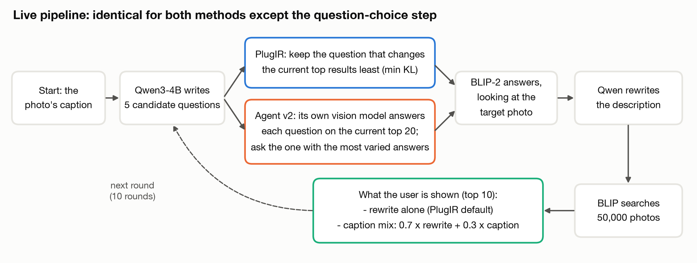
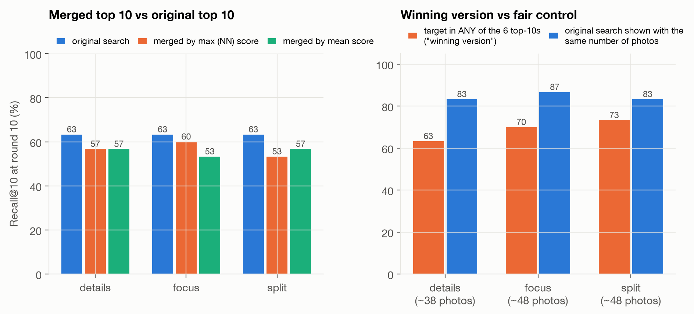
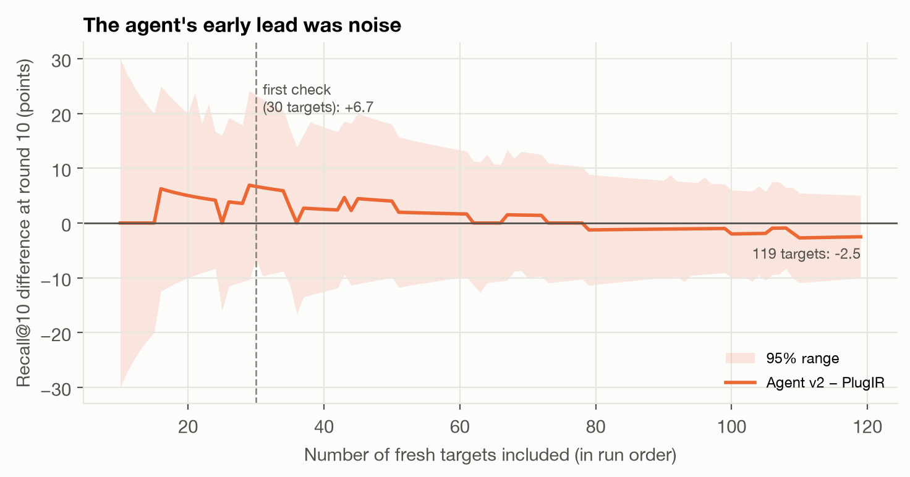
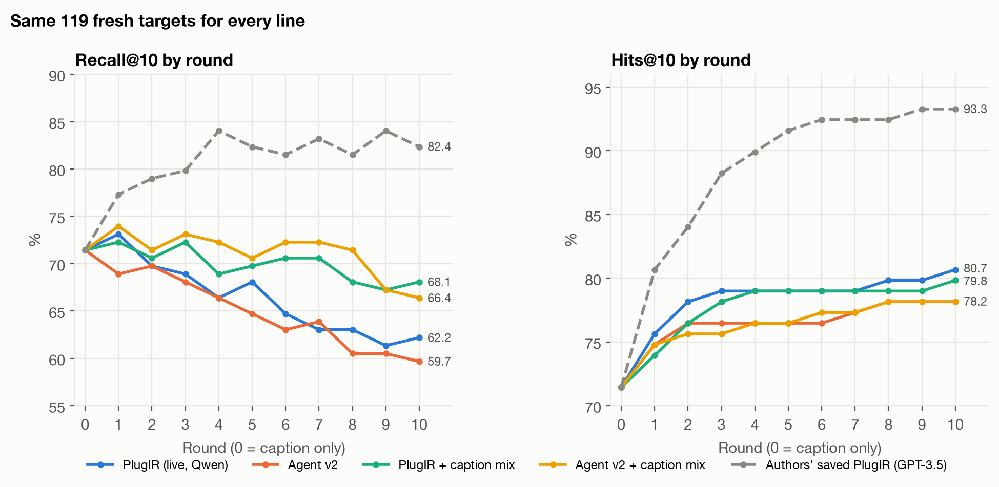
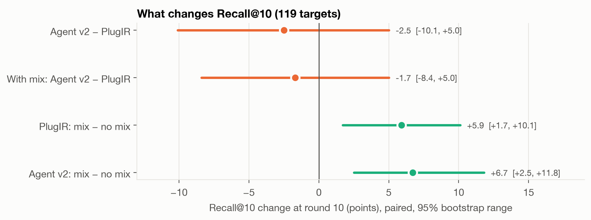
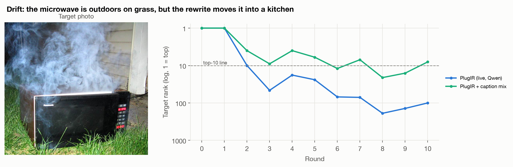
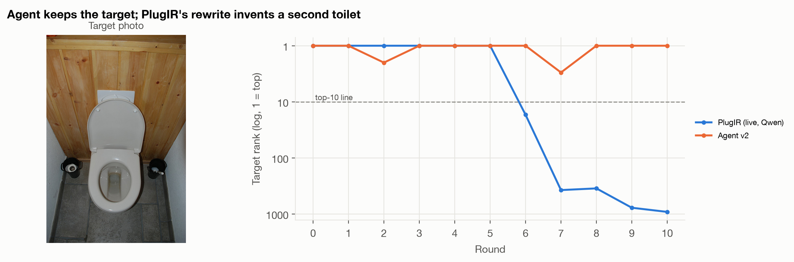
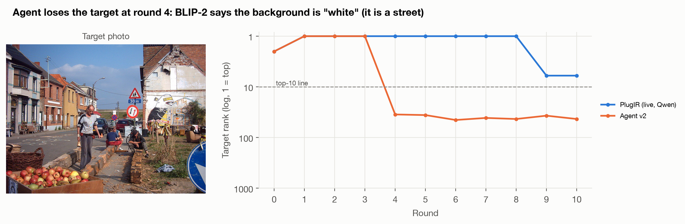

# Live experiments: agent search vs PlugIR, Matan's strategies, and the caption mix

Branch: `live-results-agent-v2-and-caption-mix` · Runs: Nov 5–9, 2026 · Author: Bilal (with Claude Code)

This is the entry point for everything we ran on **live conversations** (the full pipeline, as Matan
asked). It covers what was tested, how, the results, and where every file is, so a teammate or an AI
agent can pull the branch and analyse it without the GPU.

## TL;DR

| # | What we tested | Targets | Result |
|---|---|---|---|
| 1 | Matan's extra searches (details / focus / split, k = 6) merged by max or mean score | 30 | **Did not help.** The merged top 10 is below the original (R@10 53–60 vs 63). The "winning version" gain comes from showing more photos. |
| 2 | Agent v1: guess answers, probe-search each, ask the question that splits the candidates | 30 | **Worse** than PlugIR (R@10 50 vs 63). |
| 3 | Agent v2: own vision model answers each candidate question on the top 20; ask the most varied | 119 | **Tied** with PlugIR (R@10 −2.5 [−10.1, +5.0]); 1.5× slower. |
| 4 | Caption mix: search with 0.7 × rewrite + 0.3 × original caption | 119 | **Helps both**: R@10 +5.9 [+1.7, +10.1] for PlugIR, +6.7 [+2.5, +11.8] for the agent. |
| – | Baseline check: live PlugIR + Qwen vs the authors' saved GPT-3.5 PlugIR | 119 | **Large gap**: R@10 62.2 vs 82.4, H@10 80.7 vs 93.3. Live PlugIR ends below the caption alone (71.4). |

Values are at round 10, with paired 95% bootstrap ranges in brackets.

## Setup (identical for every method)



- **Pipeline:** Leo's wrapper around the authors' unchanged `generate_dialog.py` ([plugir_upstream.py](../../src/agentir/plugir_upstream.py), [live.py](../../src/agentir/live.py)).
  Each round:
  1. Take the top-500 window, shrinking by 50 each round.
  2. Group it into 10 KMeans clusters, and pick one representative caption per cluster.
  3. Qwen writes 5 candidate questions (`Qwen/Qwen3-4B-Instruct-2507`).
  4. Filter them and **select one**, which is the only step that differs between methods.
  5. BLIP-2 flan-t5-xl answers while looking at the target (the simulated user).
  6. Qwen rewrites the description.
  7. BLIP (`Salesforce/blip-itm-large-coco`) searches the 50,000 photos.
- **Targets:** VisDial targets in the matched-target order from `assets/protocol/`. Targets 1–30 were used for development and the first comparisons; 31–150 are fresh, and none were used to design the agent.
- **Metrics:**
  - **Recall@K:** is the target in the top K at round r?
  - **Hits@10:** was it in the top 10 at any round ≤ r?
  - **Ranges:** paired bootstrap 95% (5,000 resamples, seed 42).
- **Hardware:** one NVIDIA L4 on GCP. PlugIR takes about 8 minutes per target, agent v2 about 12.
- **Fixed in advance:** the number of targets (120), the caption share (0.3, chosen earlier on the saved GPT-3.5 data) and the decision rule. The agent wins only if the R@10 range is above zero and H@10 is not clearly lower. There was no early stopping. The run stopped at 119 matched targets because the cloud billing was suspended overnight, not because of the results.

## 1. Matan's extra-search strategies (Stage A)

**What:** each round of 30 live PlugIR conversations, Qwen writes 5 variant searches. The original description is kept, so k = 6 searches.
- **details:** the same subject, with a different detail emphasised in each variant.
- **focus:** a different main subject in each variant.
- **split:** short single-focus queries.

The top 10 of each search are pooled and re-ranked by **max (NN) score** or **mean score**. Applying this to finished conversations is exact, because the display doesn't change PlugIR's questions. Code: [extra_searches.py](../../src/agentir/extra_searches.py), [matan_strategies.py](../../matan_strategies.py).



**Result (round 10):**
- The merged top 10 is below the original for every strategy and both merges: R@10 53–60 vs 63.
- "Target in any of the 6 top-10s" reaches 63–73%. But the pooled lists hold about 38–48 photos, and the original search showing that many photos reaches 83–87%.
- So a perfect re-ranker of the pool (an agent scorer or a mosaic) could reach at most 63–73, which is below that fair control. We didn't build one.

Files: [results/extra_search_strategies/](../extra_search_strategies/). It holds `summary.csv` (per strategy and round), `per_round.csv` (per target, round and strategy) and `variants.json` (every variant Qwen wrote).

## 2. Agent v1: probe-search question selection (`probe_split`)

For each candidate question, Qwen guesses up to 3 answers. The agent searches "description + question + answer" for each guess, and picks the question whose probes split the current candidates most (soft-vote mutual information). On targets 1–30, it reached R@10 50 vs 63 for PlugIR (−13.3, range −30 to +3.3). The guessed answers were generic (often colours such as "white"), so the probes barely differed. Details: [results/agent_probe_split/README.md](../agent_probe_split/README.md).

## 3. Agent v2: vision-model probing (`probe_vlm`), the main experiment

For each factual candidate question, the agent's own vision model (`Qwen/Qwen2.5-VL-3B-Instruct`) answers it on the **current top 20 results**. The agent is never told which result, if any, is the target. The agent asks the question whose 20 answers are most varied (entropy in bits), because the user's answer to it should split the candidates. Opinion questions ("what might this symbolize?") are skipped. If every question gets identical answers, it falls back to PlugIR's KL choice; that happened in 8 of 1,190 rounds. Code: [probe_agent.py](../../src/agentir/probe_agent.py), `make_selector(..., selection="probe_vlm")`.

Neither method uses KL to measure narrowing. PlugIR's KL measures how much a question's *wording* shifts the scores, and it keeps the **smallest** shift, which acts as a stay-on-topic filter. Agent v2 instead estimates the narrowing from how varied the answers are on actual photos.

| Round 10, 119 targets | Recall@1 | Recall@10 | Hits@10 |
|---|---|---|---|
| PlugIR (live, Qwen) | 28.6 | 62.2 | 80.7 |
| Agent v2 | 34.5 | 59.7 | 78.2 |
| Difference (95% range) | +5.9 [−0.8, +13.4] | −2.5 [−10.1, +5.0] | −2.5 [−7.6, +1.7] |



The early lead (+6.7 on the first 30 fresh targets) was noise: −5.6 on the next 89. Full write-up: [results/agent_v2_vlm_probe/README.md](../agent_v2_vlm_probe/README.md).

## 4. Caption mix (drift fix)

Search with `normalize(0.7 * embed(rewrite) + 0.3 * embed(original caption))` instead of the rewrite alone. This only changes the display, so it is computed exactly on the finished conversations: re-searching the saved rewrites reproduced all 2,618 live ranks. Code: [final_results.py](../../final_results.py).





Without the mix, R@10 slides from 71 at round 0 to about 60–62 at round 10. With it, R@10 stays around 69–74 until round 8 and ends around 66–68. Hits@10 is unchanged. With the mix on both sides, the agent and PlugIR are still tied (−1.7 [−8.4, +5.0]).

## Why live PlugIR + Qwen is weak (diagnosis)

Over 1,190 rounds per method:
- **Repeated questions:** the same question is asked again in about 22% of rounds.
- **Non-answers:** in about 43% of rounds, BLIP-2 gives a sentence of 7 or more words instead of a short answer, often echoing the description.
- **Fallback question:** "what is the other object in the image?" makes up 14% of PlugIR's questions (5% of the agent's).
- **Invented details:** the rewrite makes things up. In the microwave example below, the photo is outdoors on grass, but the rewrite says "in a kitchen with white cabinets … a scream heard".

We have not isolated whether the questioner, the rewriter or the answerer causes most of the gap to GPT-3.5.

| | |
|---|---|
|  |  |
|  | Full dialogues: [example_conversations.md](example_conversations.md) |

## Files

| Path | What |
|---|---|
| `conversations/*.json` | **All live conversations**, one file per run, described below |
| `data/recall_hits_by_round.csv` | R@1, R@10 and H@10 per round for the 5 lines in Figure 3 |
| `saved_plugir_gpt35_ranks.json` | The target's rank per round for the authors' saved GPT-3.5 PlugIR queries, on the same 119 targets |
| `../agent_v2_vlm_probe/per_target_ranks.csv` | Rank per target and round for `plugir`, `plugir+mix`, `agent_v2` and `agent_v2+mix` |
| `../agent_v2_vlm_probe/summary.json` | Every round-10 number and paired difference, plus the agent's behaviour counts |
| `../extra_search_strategies/` | Stage A (Matan's strategies) |
| `figures/` | All figures above |

**Conversation files** (`conversations/`):

| File | Run | Targets |
|---|---|---|
| `plugir_qwen_targets_1_30.json` | Live PlugIR | 1–30 |
| `agent_v1_probe_split_targets_1_30.json` | Agent v1 | 1–30 |
| `plugir_qwen_targets_31_150.json` | Live PlugIR | 31–150 (120 conversations) |
| `agent_v2_probe_vlm_targets_31_149.json` | Agent v2 | 31–149 (119 conversations) |

Schema:

```
{ "description", "n_targets",
  "conversations": [ { "target": "unlabeled2017/000000xxxxxx.jpg", "caption", "selection",
      "states": [   # index 0 = caption only, 1..10 = after each round
        { "round", "query" (description searched = rewrite), "question", "answer" (BLIP-2),
          "candidate_questions" (Qwen's proposals), "candidate_caption_prompt" (cluster captions shown to Qwen),
          "target_rank" (1 = top of 50,000),
          "selection" (agent runs only: each candidate's VLM answers and score, the chosen question, fallback flag) } ] } ] }
```

## Reproducing

- **Figures** (needs the raw runs in `vm_results/`, which are local only):
  `python scripts/make_figures.py results/live_experiments results/live_experiments/saved_plugir_gpt35_ranks.json`
- **Final numbers:** `PYTHONPATH=src python final_results.py`. This also needs the raw runs and the BLIP cache in `data/`.
- **Compact export:** `python scripts/export_conversations.py`. It writes `conversations/` from `vm_results/`.
- **New live runs:** [run_evaluation.py](../../run_evaluation.py), with `SELECTION = "plugir_kl"` or `"probe_vlm"` and `RUN_LIVE_PLUGIR = True`, on a CUDA GPU.
- The raw checkpoints (about 1.8 GB including model-call caches) are on Bilal's machine in `vm_results/final_pull/`. Ask Bilal for them if you need them.

## Notes for an AI agent analysing this branch

- Use `conversations/*.json` and `per_target_ranks.csv`. Everything needed for per-round, per-target analysis is there; no GPU or model is needed.
- **Compare methods only on the same targets.** PlugIR has target 150 and the agent doesn't.
- Targets 1–30 were used during development; treat 31–149 as the held-out set.
- **Questions still open:**
  - Which pipeline part (questioner, rewriter or answerer) causes the gap to GPT-3.5?
  - Does the mix help more on targets where the rewrite adds new nouns?
  - Do the rounds where the agent and PlugIR asked different questions predict the outcome?
  - Is there a better caption share than 0.3? Tune it on 1–30 only, then report on 31–149.
